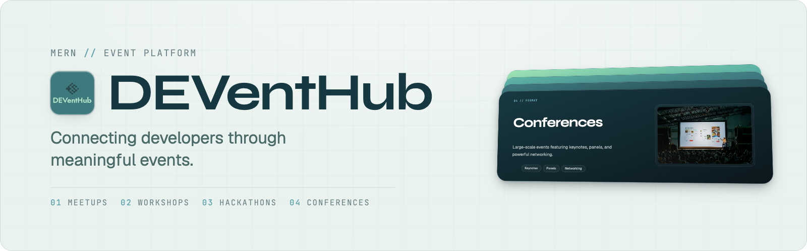
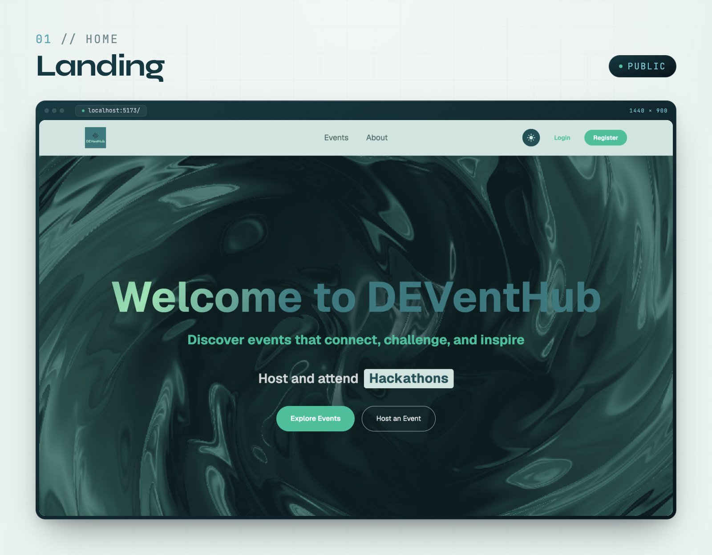
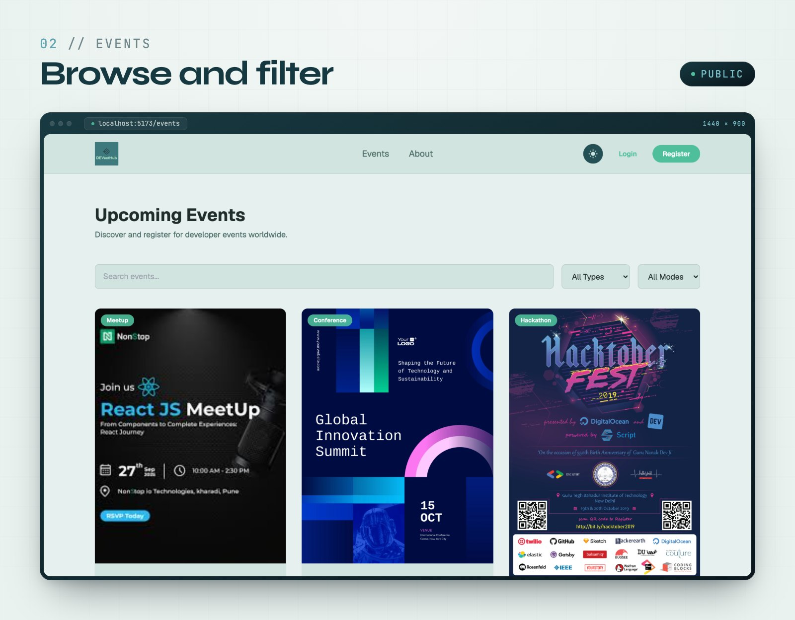
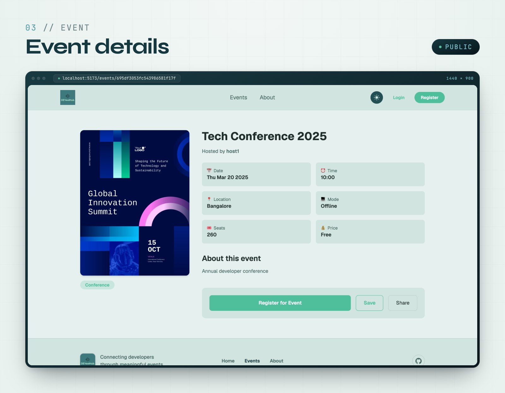
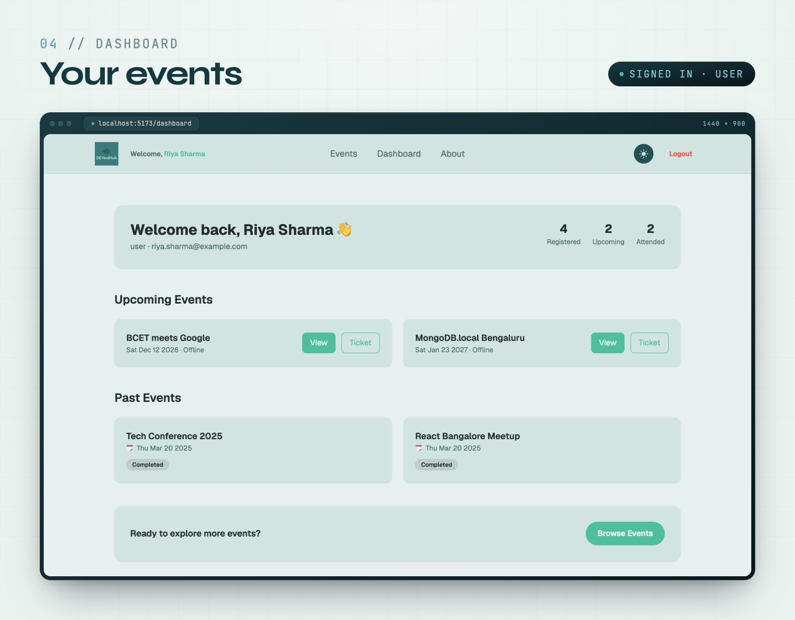
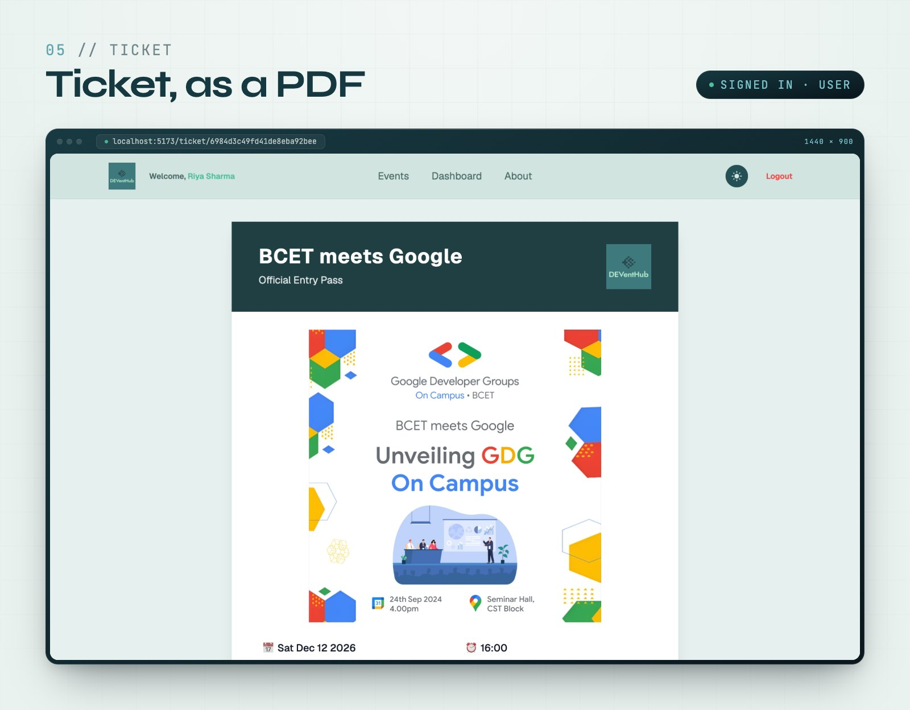
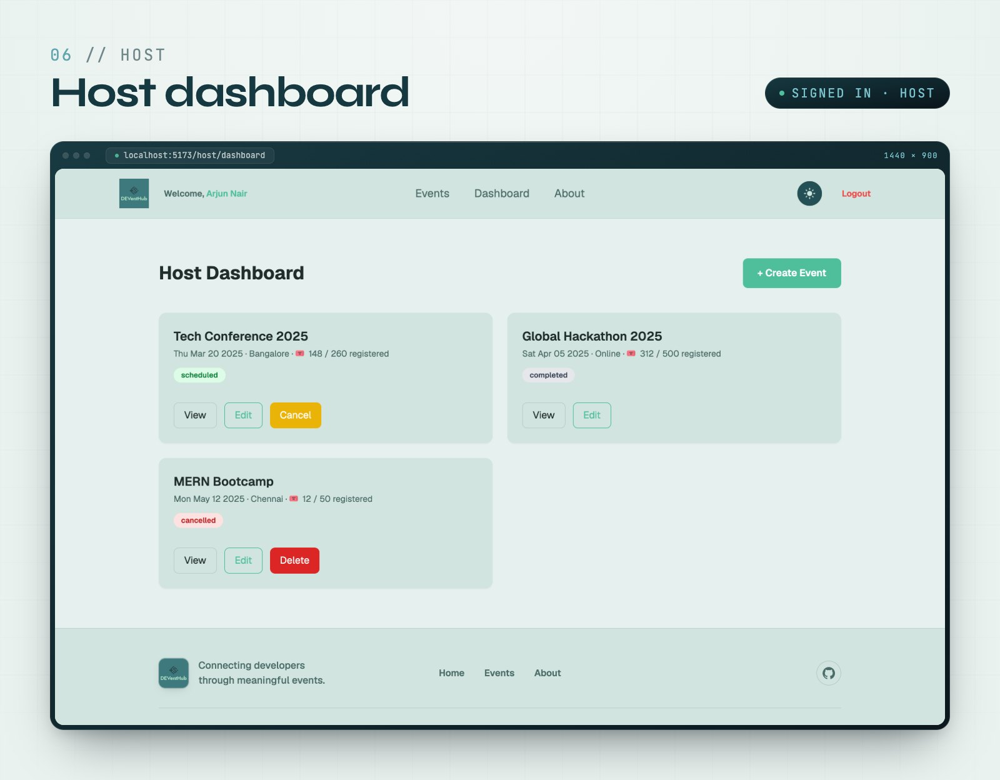
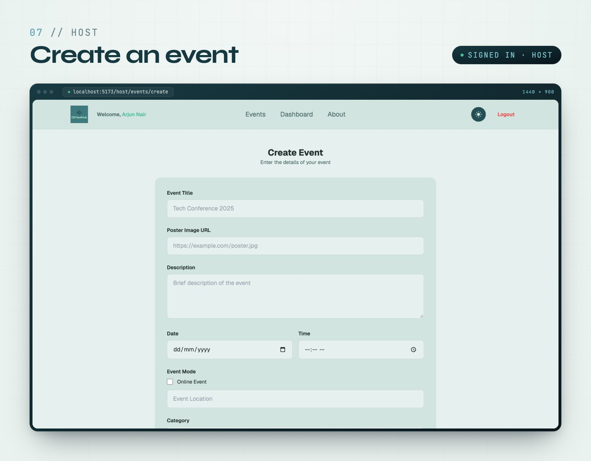
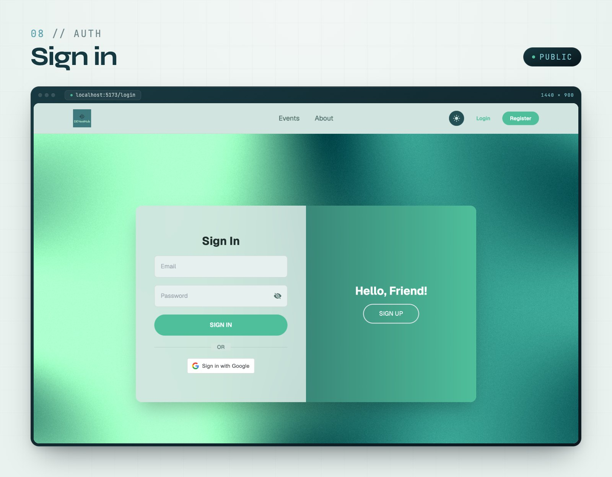
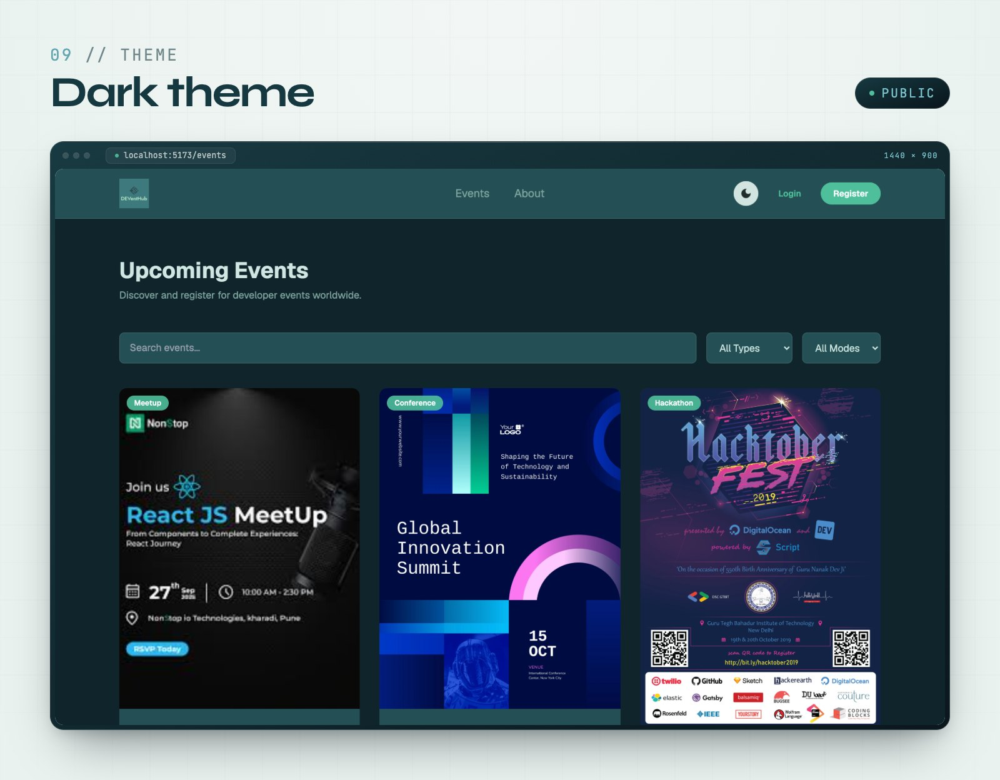

<a href="#tour">
  <picture>
    <source media="(prefers-color-scheme: dark)" srcset="docs/media/banner-dark.png">
    
  </picture>
</a>

<p align="center">
  <b>A full-stack platform for developer events.</b><br>
  Attendees find, register for and keep tickets to conferences, meetups, workshops and hackathons.<br>
  Hosts publish events and track who's coming.
</p>

<p align="center">
  
  
  
  
  
  
  
</p>

<p align="center">
  <a href="#tour">Tour</a> &nbsp;·&nbsp;
  <a href="#features">Features</a> &nbsp;·&nbsp;
  <a href="#run-it-locally">Run it locally</a> &nbsp;·&nbsp;
  <a href="#architecture">Architecture</a> &nbsp;·&nbsp;
  <a href="#showcase-reel">Showcase reel</a>
</p>

<a href="showcase-video/">
  
</a>

<p align="center"><sub>A 13-second cut of the 60 fps showcase reel, rendered from the running app with Remotion. <a href="showcase-video/">How it's made →</a></sub></p>

<br>

<sup><code>01 // TOUR</code></sup>

## Tour

### Landing



The landing page opens on a live WebGL shader (Balatro, rendered with `ogl`) behind the headline. Under it, the line **Host and attend …** cycles through Meetups, Hackathons, Workshops and Bootcamps, and two calls to action lead to **Explore Events** and **Host an Event**. Further down the page:

- **Featured Events**: posters on a 3D image ring.
- **Globe**: an interactive `cobe` globe.
- **What We Host**: four format cards (Meetups, Workshops, Hackathons, Conferences) that pin and stack as you scroll. Each card has a cursor spotlight, a brightening top edge and a slow photo zoom on hover, and its layout reflows from a 7/5 split on desktop to a stacked card on phones.

### Finding an event

<p>
  &nbsp;
  
</p>

- **Events** (`/events`): search by title, then filter by type (Meetup, Hackathon, Workshop, Conference) and mode (online or offline). Results show three to a page, and changing a filter returns you to page 1.
- **Event details** (`/events/:id`): the poster, category, date and time, venue or *Online*, price, and capacity (*Unlimited* when the host sets none). **Register for Event** starts registration. If you aren't signed in, you're sent to sign in and then straight back.

### Attending

<p>
  &nbsp;
  
</p>

- **Registration**: review the event, then check out. Free events confirm straight away; paid events go through Stripe Checkout in test mode. Either way you land on a confirmation page with links to your dashboard and back to events.
- **Your events** (`/dashboard`): counts of registered, upcoming and attended events, then both lists as cards. Every card links to the event's details and to its ticket.
- **Ticket** (`/ticket/:id`): an A4 pass with the event, date, venue, ticket ID and attendee. **Download Ticket** renders it in the browser with html2canvas and saves it with jsPDF as `<Event_Title>_<ticketId>.pdf`.

### Hosting

<p>
  &nbsp;
  
</p>

- **Host dashboard** (`/host/dashboard`): every event you've created, with its status (*scheduled*, *completed* or *cancelled*) and registrations against capacity. You can view and edit any event, cancel a scheduled one, and delete a cancelled one. Cancelling and deleting both ask you to confirm first.
- **Create an event** (`/host/events/create`): title, poster URL, description, date and time, online or a venue, category, free or paid with a price, and capacity. A paid event needs a valid price. Editing (`/host/events/edit/:id`) uses the same form.

### Accounts and theme

<p>
  &nbsp;
  
</p>

- **Sign in / Create account** (`/login`, `/register`): one page whose panel slides between the two forms. New accounts choose a role, *user* or *host*. Google sign-in is available for users and creates a user account.
- **Dark theme**: the toggle in the navbar switches every page to the dark palette and remembers your choice.

<br>

<sup><code>02 // FEATURES</code></sup>

## Features

|                                   | Visitor            | Attendee (`user`)                   | Host (`host`)                            |
| --------------------------------- | ------------------ | ----------------------------------- | ---------------------------------------- |
| Browse, search and filter events  | ✓                  | ✓                                   | ✓                                        |
| Register for free or paid events  | sign in first      | ✓                                   | –                                        |
| Dashboard                         | –                  | registered, upcoming, attended      | own events, status, registrations        |
| Download tickets as PDF           | –                  | ✓                                   | –                                        |
| Create, edit, cancel, delete      | –                  | –                                   | ✓                                        |
| Sign in with                      | –                  | email and password, or Google       | email and password                       |

Routes are guarded twice:
- **In the browser:** `ProtectedRoute` sends signed-out visitors to sign in and the wrong role to its own home page.
- **On the API:** `userOnly` and `hostOnly` middleware check the JWT's role.

<br>

<sup><code>03 // RUN</code></sup>

## Run it locally

You need Node.js 20+ and a MongoDB instance (local or Atlas).

```bash
# Backend
cd event-hub-backend
cp .env.example .env        # MONGODB_URI, JWT_KEY, GOOGLE_CLIENT_ID, STRIPE_SECRET_KEY, CLIENT_URL
npm install
npm run dev                 # http://localhost:3000

# Frontend (second terminal)
cd event-hub-frontend
cp .env.example .env        # VITE_API_URL=http://localhost:3000, VITE_GOOGLE_CLIENT_ID
npm install
npm run dev                 # http://localhost:5173
```

### Tests

```bash
# Backend: API tests against an in-memory MongoDB (no database setup needed)
cd event-hub-backend && npm test

# Frontend: unit tests for session handling, the API client and route guards
cd event-hub-frontend && npm test
```

The backend suite covers:
- password hashing, login and token validation
- the host-only and owner-only guards
- the public event shape (no attendee emails)
- registration idempotency, and capacity under concurrent requests

> [!NOTE]
> Payments are intentionally demo-grade. Registration is confirmed when the
> success page loads; there is no Stripe webhook verification.

### Deploying

There's no live demo yet. A suggested setup: frontend on **Vercel** or **Netlify**, backend on **Render** or **Railway**, database on **MongoDB Atlas**.

<br>

<sup><code>04 // ARCHITECTURE</code></sup>

## Architecture

```
            Browser
               │
               ▼
   React 19 + Vite  ──────────────►  PDF tickets (html2canvas + jsPDF, in the browser)
   event-hub-frontend
               │  axios · JWT bearer token
               ▼
   Express 5 API
   event-hub-backend
      ┌────────┼─────────────────┐
      ▼        ▼                 ▼
   MongoDB   Google OAuth       Stripe Checkout
   Mongoose  google-auth-library (test mode)
```

### API

| Method              | Route                                                          | Access     |
| ------------------- | -------------------------------------------------------------- | ---------- |
| `POST`              | `/api/register` · `/api/login` · `/api/google-login`           | public     |
| `GET`               | `/api/getAllEvents` · `/api/getSingleEvent/:id`                | public     |
| `POST` `PUT` `DELETE` | `/api/addEvent` · `/api/updateEvent/:id` · `/api/deleteEvent/:id` | host       |
| `GET`               | `/api/host/events`                                             | host       |
| `POST`              | `/api/events/:id/confirm-registration`                         | user       |
| `GET`               | `/api/user/registrations` · `/api/events/:id/ticket`           | user       |
| `POST`              | `/api/create-checkout-session`                                 | user, demo |

### Authentication

- **Email and password:** passwords are hashed with bcrypt. Login returns a JWT carrying the account's email and role, and the frontend sends it as a bearer token.
- **Google:** the backend verifies the Google ID token with `google-auth-library`, then issues the same kind of JWT. Google accounts are always users. Hosts sign up with email and password.

### Stack

**Frontend:** React 19 and React Router 7 on Vite 7, styled with Tailwind CSS 3.
- **Data:** Axios for the API, `@react-oauth/google` for Google sign-in.
- **Motion and 3D:** Motion and Lenis, plus `ogl` (the hero shader), `cobe` (the globe) and lightswind (the image ring).
- **Tickets:** html2canvas and jsPDF.
- **Tests:** Vitest and Testing Library.

**Backend:** Express 5 on Node.js, with MongoDB through Mongoose 9.
- **Auth:** jsonwebtoken and bcryptjs, plus google-auth-library for Google sign-in.
- **Payments:** the Stripe SDK, in test mode.
- **Tests:** `node:test` against `mongodb-memory-server`.

### Project structure

```
deventhub-mern/
├── event-hub-frontend/      React + Vite app
│   └── src/
│       ├── pages/           landing, sign in / sign up, about, 404
│       ├── users/           events, details, registration, checkout, ticket, dashboard
│       ├── host/            host dashboard, create and edit event
│       ├── components/      navbar, footer, format stack, ring, globe, shaders, animations
│       ├── context/         auth and theme
│       ├── routes/          ProtectedRoute (role guards)
│       ├── services/        API client
│       └── lib/             session, route helpers
├── event-hub-backend/       Express API
│   ├── app.js               Express app
│   ├── index.js             DB connect + listen
│   ├── router/              route table
│   ├── controllers/         users, events, payments
│   ├── models/              User, Event
│   ├── middleware/          JWT and role guards
│   ├── config/
│   └── test/
├── showcase-video/          Remotion product reel
└── docs/media/              README images, rendered by showcase-video
```

<br>

<sup><code>05 // SHOWCASE</code></sup>

## Showcase reel

[`showcase-video/`](showcase-video/) renders a 60-second product reel of the app with [Remotion](https://www.remotion.dev): 1920 × 1080 at 60 fps, in six acts, with no hard cuts. Its last frame matches its first, so it loops seamlessly. The format cards, footer and hero shader are rebuilt as components so hover states animate frame by frame; the other pages are 2× captures of the running app. The GIF and every image above are rendered from it.

```bash
cd showcase-video
npm install
npm run capture         # frontend on :5173 and backend on :3000 must be running
npm run render          # → out/deventhub-showcase.mp4
npm run readme:media    # → docs/media (banner, screenshots, GIF)
```

See [`showcase-video/README.md`](showcase-video/README.md) for what each act shows and how it's built.

<br>

<sup><code>06 // ROADMAP</code></sup>

## Roadmap

- Email notifications and event reminders
- QR code ticket verification
- Stripe webhooks, so payment confirms registration on the server
- Host analytics and real-time attendee tracking
- An admin moderation panel
- Event reviews and ratings

## What this project demonstrates

- Full-stack MERN development
- OAuth authentication
- Payment gateway integration
- RESTful API architecture
- Role-based application design

## License

MIT License

## Author

**Aaron Correya**: full-stack developer passionate about building scalable web applications.
