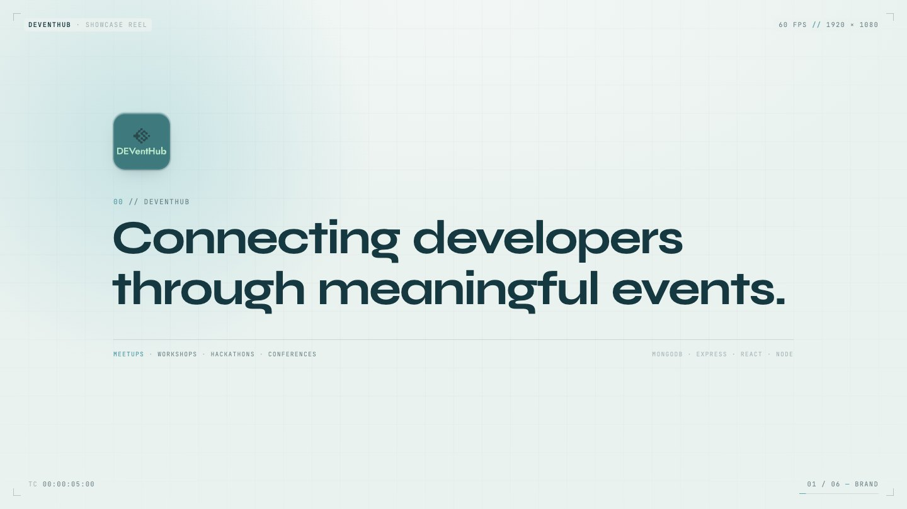
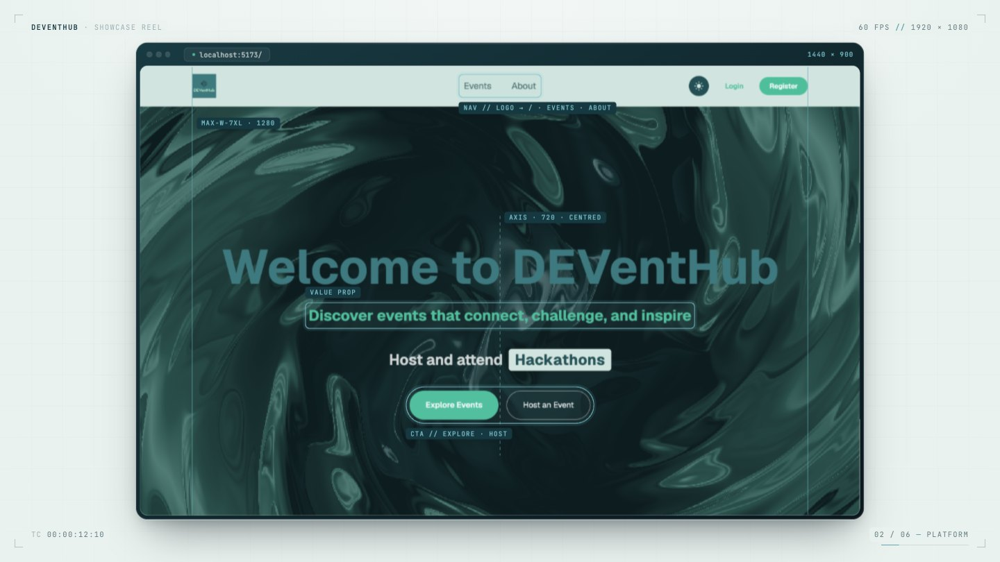
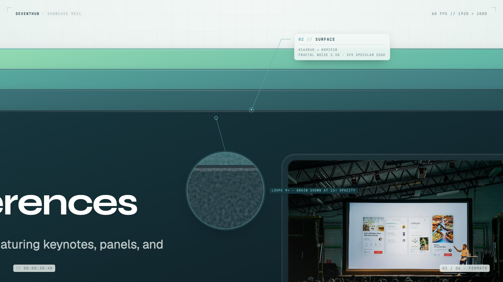
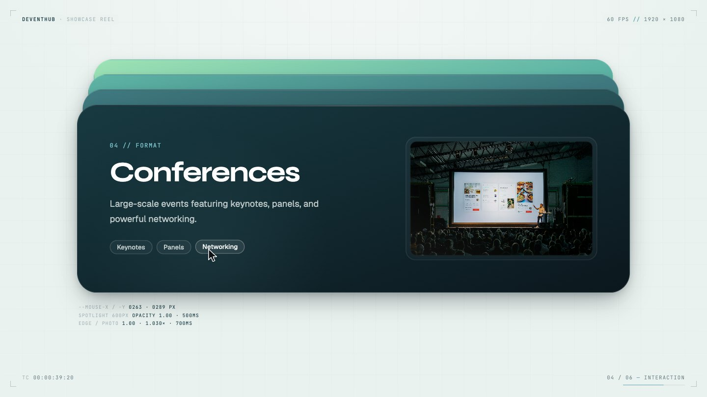
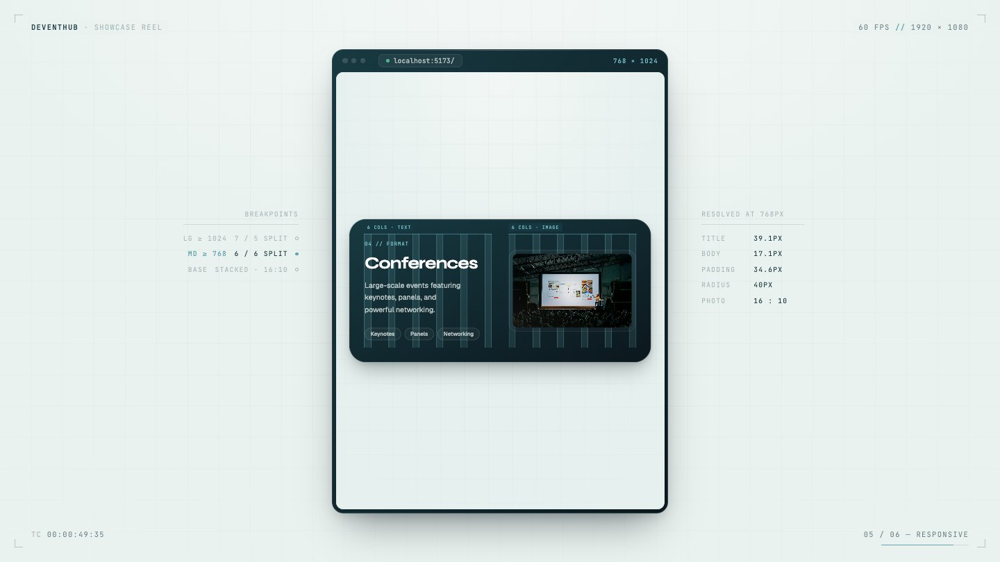
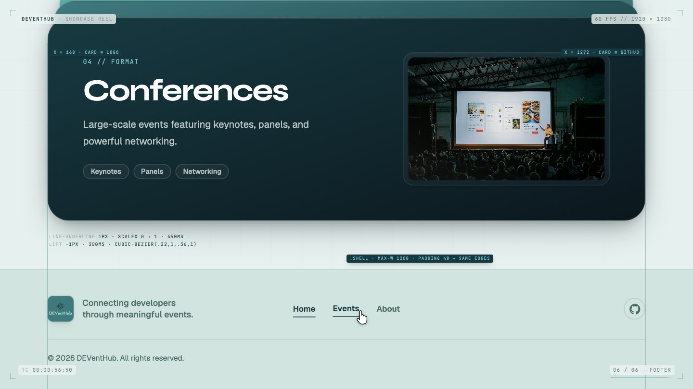

# DEVentHub showcase reel

A 60-second product reel for DEVentHub, built with [Remotion](https://www.remotion.dev): 1920 × 1080, 60 fps, 3600 frames. It runs in six acts with no hard cuts, and the last frame matches the first, so it loops seamlessly.


<p align="center"><sub>The 13-second GIF cut, also built from this project (<code>ReadmeTeaser</code>). Render the full reel with <code>npm run render</code>.</sub></p>

## Run it

```bash
cd showcase-video
npm install

# 1. Capture the live app (frontend on :5173 and backend on :3000 must be running)
npm run capture

# 2. Preview in Remotion Studio
npm run dev

# 3. Render the final file → out/deventhub-showcase.mp4
npm run render

# 4. Optional: re-render the repo README's images into ../docs/media
npm run readme:media
```

`npm run capture` takes about a minute. Re-run it whenever the app's UI or data changes.

## The six acts

<sup><code>01 // BRAND</code></sup> &nbsp;<sub>frames 0–480 · 0–8 s</sub>

### Act 1 · Brand



- The 60px grid draws itself in from the top and left edges, then the rounded logo badge springs in.
- The eyebrow `00 // DEVentHub` types on. The tagline *Connecting developers through meaningful events.* rises word by word through masks, its tracking tightening from 0.01em to −0.03em.
- A hairline draws under the tagline and the four format names type along it, followed by a glint.
- Corner chips hold the brand, `60 FPS // 1920 × 1080`, a running timecode and the act index, which rolls over as each act begins.

<sup><code>02 // PLATFORM</code></sup> &nbsp;<sub>frames 480–1200 · 8–20 s</sub>

### Act 2 · Platform



- **Shared-element morph:** the badge expands into the browser frame. The landing hero's Balatro shader runs live, and *Host and attend …* cycles with the app's own spring.
- **Layout inspector:** the centre axis at 720, the `max-w-7xl` (1280px) container edges, and labelled boxes on the nav, value proposition and calls to action.
- **Rest of the page:** it scrolls through Featured Events (the 3D ring) and the globe, then pulls back into a 3 × 3 wall of real routes at their real URLs:
  - event details and sign in
  - registration, the dashboard and the ticket
  - the host dashboard and create event
  - the dark theme
- **Z-space push:** the wall drifts past the camera with depth-of-field blur while the next scene scales from 0.94 to 1.

<sup><code>03 // FORMATS</code></sup> &nbsp;<sub>frames 1200–2160 · 20–36 s</sub>

### Act 3 · Formats



- The **What We Host** stack, replayed frame by frame from the app's ScrollStack maths, under a `rotateX(4deg) rotateY(-6deg)` tilt that settles flat as the stack pins.
- The camera flies between four callouts on the Conferences card:
  1. the `04 // Format` eyebrow and Syne hierarchy;
  2. the surface: a `#163840 → #09151B` gradient, 2.5% fractal noise and a 1px specular edge, with a 9× magnifier on the grain;
  3. the Keynotes, Panels and Networking pills;
  4. the glass bezel (8px padding, 20px radius).
- It ends on a wide shot with all four labels.

<sup><code>04 // INTERACTION</code></sup> &nbsp;<sub>frames 2160–2760 · 36–46 s</sub>

### Act 4 · Interaction



- **Hover:** a cursor crosses the card. The 600px spotlight follows it, the top edge brightens, the photo scales to 1.03 over 700 ms, and each pill lifts as it passes. Each one replays the app's own CSS transition timing, and a readout tracks `--mouse-x` / `--mouse-y` and each state.
- **Shared-element morph:** the card's bezel expands to become the viewport for `/events`. The type filter is set to Conference, and the grid narrows to the two matching events.
- **Spotlight wipe:** clicking **About** opens `/about` through a wipe that grows from the link.

<sup><code>05 // RESPONSIVE</code></sup> &nbsp;<sub>frames 2760–3180 · 46–53 s</sub>

### Act 5 · Responsive



- A spotlight wipe opens on the Conferences card at 1440px, with the card's 12-column grid overlaid on its 7 / 5 split.
- The frame morphs to 768 × 1024, where the card splits 6 / 6, then to 390 × 844, where it stacks with a 16:10 photo.
- Side panels show the breakpoint ladder and the live `clamp()` results (title, body, padding, radius) at each width.

<sup><code>06 // FOOTER</code></sup> &nbsp;<sub>frames 3180–3600 · 53–60 s</sub>

### Act 6 · Footer



- The phone frame expands into the full-width page, and the camera glides down to the footer.
- Guides at x = 168 and x = 1272 show that the card and the footer share the `.shell` edges (max-w 1200, padding 48). The logo lines up with the card's left edge and GitHub with its right.
- The cursor hovers Home, Events and About (a 1px left-to-right underline and a −1px lift), then the 40 × 40 GitHub button.
- **End card:** the footer logo flies back to the badge and the tagline returns. The grid then retracts in the direction it drew in, landing on frame 0.

## How it's built

The reel combines two techniques, chosen per surface:

| Surface | Technique | Why |
| --- | --- | --- |
| Format cards, footer, logo tile | Vector ports in `src/app/`, driven per frame | Stays sharp at any zoom. Hover states (spotlight, edge, photo scale, pill lift, underline) and breakpoints become props, so they animate deterministically. |
| Landing hero background | `Balatro.tsx`, the app's shader verbatim, with `iTime` taken from the frame | The hero moves for real instead of being a still. |
| Hero "Host and attend …" line | `RotatingLine.tsx` | Same words, cadence and spring as `RotatingText`, with pill widths measured in the app. |
| Every other page (events, details, about, auth, dashboards, ticket, create event, globe, featured ring) | 2× Playwright captures composited in browser frames | Real data and real WebGL, at exactly what the app renders. |

`scripts/capture.mjs` launches Chromium in new-headless mode on the GPU (ANGLE/Metal on macOS). The default headless shell renders the cobe globe as a black disc. Signed-in pages use a demo session with the signed-in endpoints mocked, so nothing is written to the database. The script also writes `src/generated/captures.json`, which records each capture's size, the element rects the cursor and callouts aim at, and layout measured in the live app: the Conferences card at 1440/768/390, the stack geometry, the footer, and the rotating-word widths.

All timing lives in `src/timeline.ts` and the act files under `src/acts/`. Motion uses the brief's spring (`damping 22, stiffness 120, mass 0.9`) and the app's `cubic-bezier(0.22, 1, 0.36, 1)`. App hover states replay their CSS durations: 300, 450, 500 and 700 ms.

## README media

`npm run readme:media` renders the repo README's images into `../docs/media` from the compositions in Remotion Studio's **README** folder. Names and frames are listed in `src/readme/media.json`.

| File | Composition | What it is |
| --- | --- | --- |
| `banner-light.png`, `banner-dark.png` | `ReadmeBanner` | Header in the app's light and dark themes (GitHub picks one with `<picture>`) |
| `shot-*.jpg` | `ReadmeShots` | Each route's capture in the reel's browser frame, with its title and who can open it |
| `act-*.jpg` | `ReadmeActs` | One still per act, frozen from the reel |
| `showcase.gif` | `ReadmeTeaser` | Four excerpts joined with spotlight wipes, from reel frame 0 to 3599, so it loops. Encoded at 960px and 20 fps (every 3rd frame) with one 128-colour palette, which keeps it under 8 MB. |

GitHub only plays video inline when it's uploaded through its web editor, not from files committed to the repo. To put the full reel in a README or PR:
1. Run `npm run readme:media -- --github-mp4`. It writes `out/deventhub-showcase-github.mp4`, a 720p cut under GitHub's 10 MB limit for free plans.
2. Drag that file into the editor on github.com.
3. Leave the `https://github.com/user-attachments/assets/…` link it inserts on its own line.

## Keeping it in sync

The ports in `src/app/` mirror `EventScrollStack.jsx`, `Footer.jsx` and the `.format-card*` / `.link-underline` / `.logo-tile` rules in `src/index.css`. If those change, update the ports by hand, then re-run `npm run capture` and `npm run readme:media`.

`public/captures/`, `public/formats/`, `src/generated/` and `out/` are generated and gitignored. The rendered README images in `../docs/media/` are committed.
